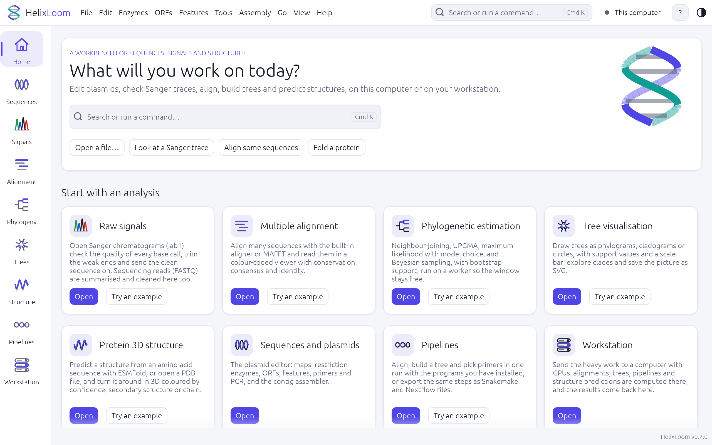
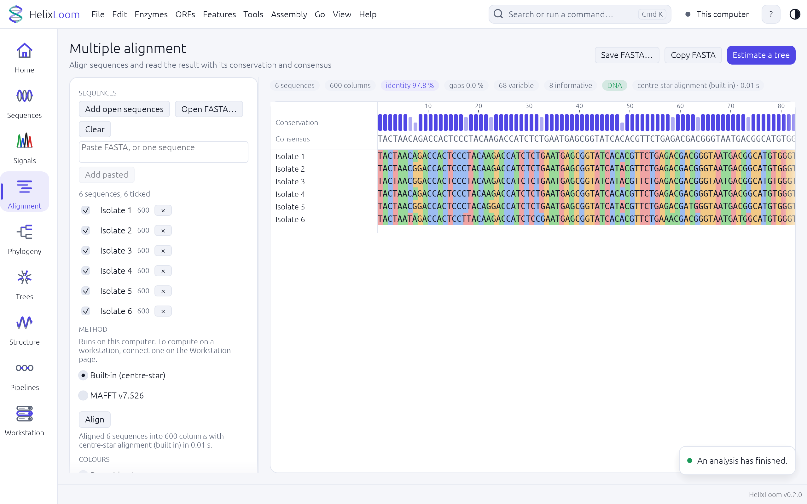
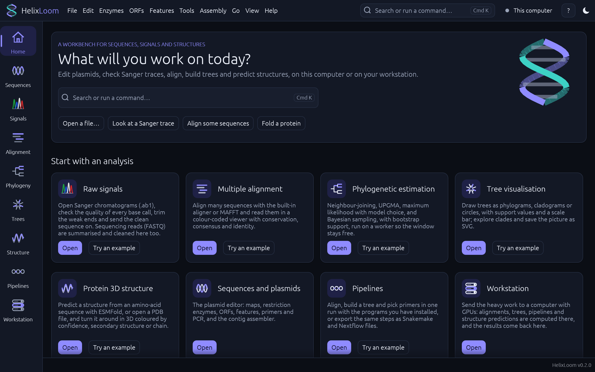
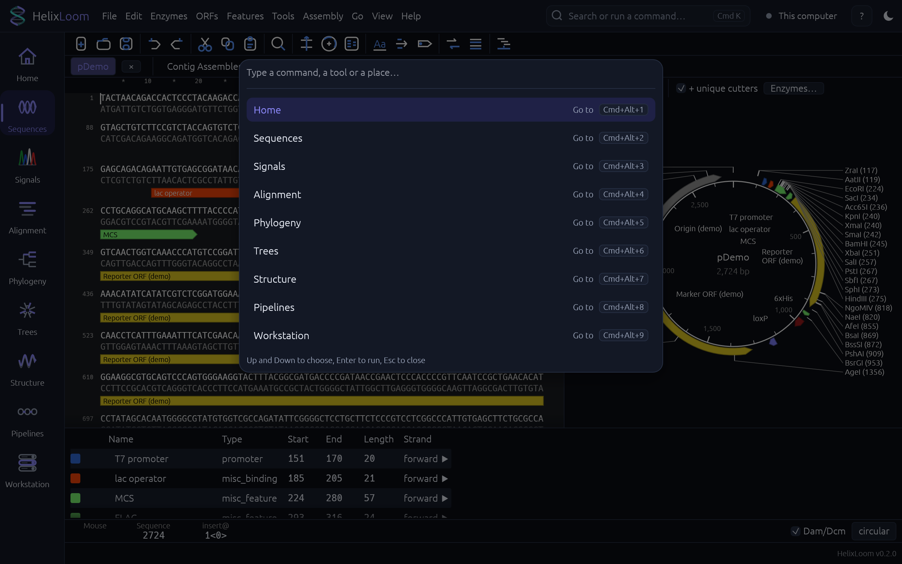

# HelixLoom

A bioinformatics workbench: edit plasmids, check Sanger traces, align sequences, build and draw phylogenetic trees, predict
and view protein structures, and run several steps as one pipeline, on your own computer or, for the heavy jobs, on a
workstation with GPUs. It is written in Rust with [egui](https://github.com/emilk/egui), so the same code can run on macOS,
Windows and Linux (so far it has only been tried on a Mac) and in a web browser ([docs/WEB.md](docs/WEB.md)).

*HelixLoom was called ApECraft until November 2026. It began as a re-creation of the behaviour of the plasmid editor
[ApE](https://jorgensen.biology.utah.edu/wayned/ape/) by M. Wayne Davis and has grown into a platform of its own; the
interface is no longer modelled on ApE's. See [CREDITS.md](CREDITS.md).*

| Home (light) | Alignment (light) |
|---|---|
|  |  |
|  |  |

## What it does

| Workspace | What you can do |
|-----------|-----------------|
| **Sequences** | Read and edit DNA, see circular and linear maps, restriction sites and digests (with silent and diagnostic sites, and lists of the enzymes by name, number of sites or site), ORFs, features, primers and PCR; assemble reads into contigs; Gibson and other assemblies; calculators (Tm and GC, molar-ratio reactions, master mixes, molarity) |
| **Signals** | Open Sanger traces (.ab1, .scf), see the quality of every base, trim the weak ends, reverse-complement, export; summarise and clean sequencing reads (FASTQ) |
| **Alignment** | Multiple sequence alignment with the built-in aligner or MAFFT; a viewer with conservation, consensus and identity |
| **Phylogeny** | Distance, maximum-likelihood (with model choice) and Bayesian trees with bootstrap support, or IQ-TREE; the species tree from many gene trees, with a posterior probability on every branch (the ASTRAL method, also as `helixloom astral`); PhyloCNN epidemic estimates |
| **Trees** | Draw phylograms, cladograms and circular trees; Newick tools; SVG export |
| **Structure** | Predict a structure with ESMFold, or open a PDB file; a 3D viewer coloured by confidence, secondary structure or chain |
| **Pipelines** | Align, build a tree and pick primers in one run; export the same steps as Snakemake and Nextflow files |
| **Workstation** | Send alignments, trees, species trees, pipelines and structure predictions to a server with GPUs and get the results back. Every heavy job has the same choice: this computer, the workstation, or automatic |

Press **Cmd+K** (Ctrl+K on Windows and Linux) to search every command and tool, or drop a file on the window and it opens in the
right place. The theme follows your system, or choose light or dark.

## Build and run

You need a recent stable [Rust](https://rustup.rs). Then:

```sh
cargo run --release                     # the app
cargo run --release -- my.gb trace.ab1  # open files
cargo run --release -- --view home --screenshot home.png --no-window   # a picture of a screen, with no window
cargo test                              # the tests
```

`--view` takes the name of a workspace (`home`, `sequences`, `signals`, `alignment`, `phylogeny`, `trees`, `structure`,
`pipelines`, `workstation`) or of a tool window; `--dark` starts in the dark theme.

The default build uses the GPU for PhyloCNN through [candle](https://github.com/huggingface/candle) (Metal on a Mac). Without
it: `cargo build --release --no-default-features`. For an NVIDIA workstation: `--features cuda` (needs the CUDA toolkit).

### The workstation server

```sh
helixloom token > token.txt
helixloom serve --listen 127.0.0.1:7878 --token-file token.txt --data-dir ./data --gpus auto
```

[DEPLOY.md](DEPLOY.md) explains every step (an SSH tunnel, a systemd service, a folding program on the GPUs). With two or
more GPUs, the Workstation page asks how many one job is given (**GPUs for one job**): PhyloCNN shares its trees among
them, and `--fold-gpus N` tells the server that a folding program can use more than one. The CUDA path for several GPUs has
not been run on real hardware.

### The web version

```sh
rustup target add wasm32-unknown-unknown
trunk build --release        # makes dist/, a static site: index.html, one .js and one .wasm file
```

[docs/WEB.md](docs/WEB.md) says how to serve it and what works there so far (the same interface, the editor, the viewers and
the small jobs; not yet the workstation, external programs or saved settings).

## Model files that are not in this repository

A few analyses need files that belong to other projects and have no licence that lets this repository pass them on (the
PhyloCNN networks). The program looks for them in a models folder and says so when they are missing:
[docs/MODELS.md](docs/MODELS.md).

## Documents

* [docs/ROADMAP.md](docs/ROADMAP.md): what to add for a better experience and better pipelines
* [docs/SPECIES.md](docs/SPECIES.md): species trees from gene trees (the ASTRAL method): how to use it, what it was checked against
* [docs/DESIGN.md](docs/DESIGN.md): the design system of the new interface
* [docs/WEB.md](docs/WEB.md): the web version
* [docs/MODELS.md](docs/MODELS.md): model files
* [DEPLOY.md](DEPLOY.md): the workstation server
* [MECHANICS.md](MECHANICS.md) and [mechanics.json](mechanics.json): every rule, default and number that came from
  ApE, with its source, and how each was checked
* [CREDITS.md](CREDITS.md): who did what first, and the thanks

## Status

Early. Everything is tested (`cargo test`: unit tests, end-to-end tests that start the real server, and golden comparisons
with reference programs), but the workstation server has only been tried on one Mac with pretend GPUs, and the program has
not been validated for clinical or diagnostic use.

## Licence

No licence has been chosen yet, so by default all rights are reserved. The code in this repository was written for this
project; what it re-implements, and the data it uses, are listed in [CREDITS.md](CREDITS.md).
