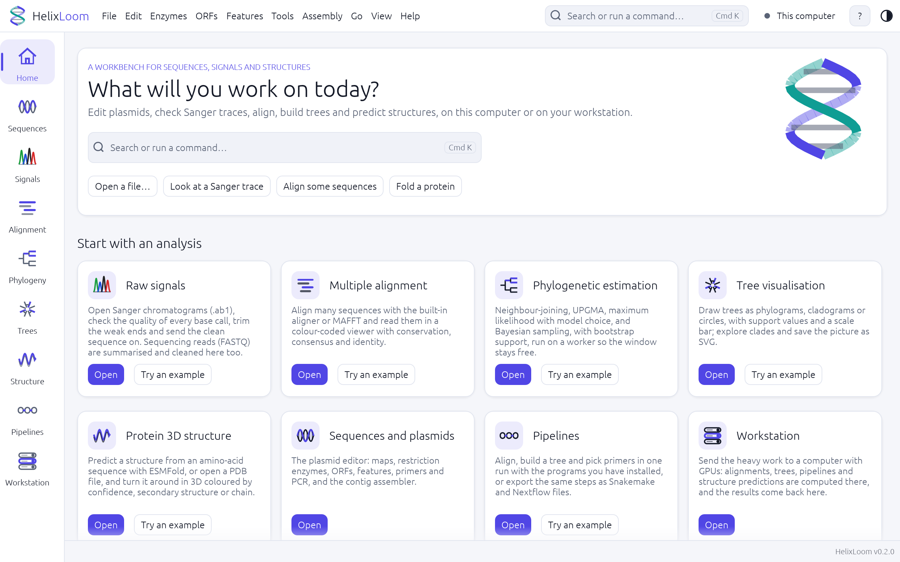
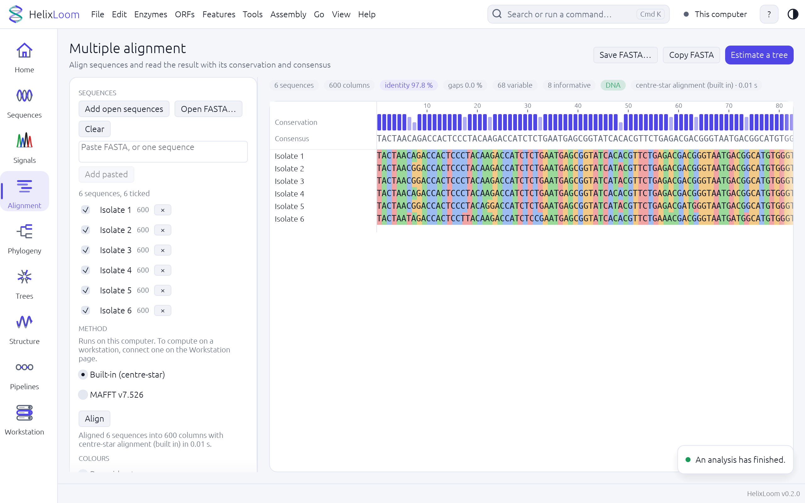
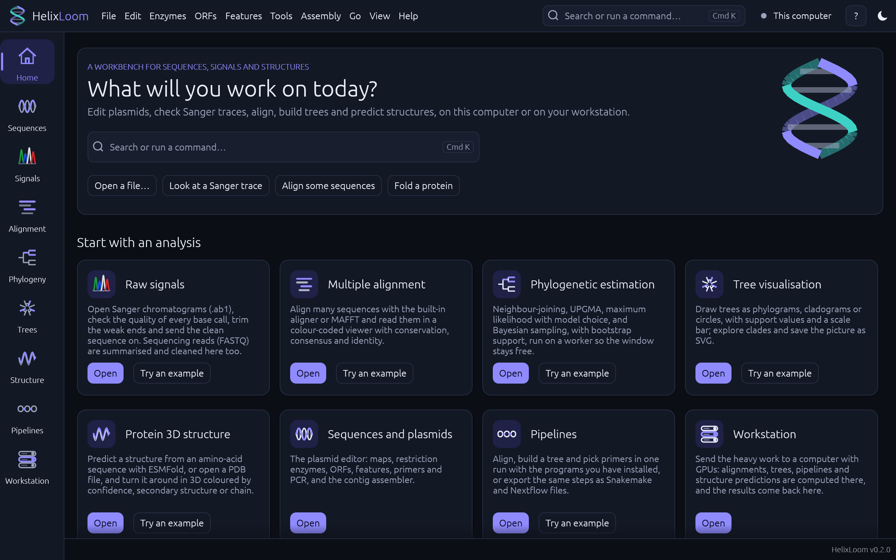
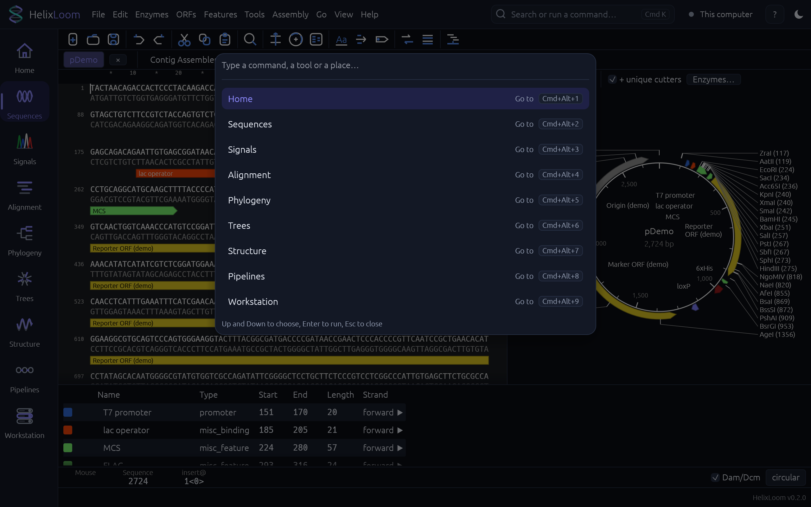

# HelixLoom

A bioinformatics workbench: edit plasmids, check Sanger traces, align sequences, build and draw phylogenetic trees, predict
and view protein structures, and run several steps as one pipeline, on your own computer or, for the heavy jobs, on a
workstation with GPUs. It is written in Rust with [egui](https://github.com/emilk/egui), so the same code can run on macOS,
Windows and Linux (so far it has only been tried on a Mac) and in a web browser ([docs/WEB.md](docs/WEB.md)).

*HelixLoom was called ApECraft until November 2026. It began as a re-creation of the behaviour of the plasmid editor
[ApE](https://jorgensen.biology.utah.edu/wayned/ape/) by M. Wayne Davis and has grown into a platform of its own; the
interface is no longer modelled on ApE's. See [CREDITS.md](CREDITS.md).*

| Home (light) | Alignment (light) |
|---|---|
|  |  |
|  |  |

## What it does

| Workspace | What you can do |
|-----------|-----------------|
| **Sequences** | Read and edit DNA, see circular and linear maps, restriction sites and digests (with silent and diagnostic sites, and lists of the enzymes by name, number of sites or site), ORFs, features, primers and PCR (**Tools → Primer3 Pair Design**, with a TaqMan probe between the primers when asked for); assemble reads into contigs; Gibson and other assemblies; calculators (Tm and GC, molar-ratio reactions, master mixes, molarity) |
| **Signals** | Open Sanger traces (.ab1, .scf), see the quality of every base, trim the weak ends, reverse-complement, export; summarise and clean sequencing reads (FASTQ) |
| **Alignment** | **Type a genome against a downloaded MLST scheme** from the command line, in the manner of mlst: `helixloom mlst --scheme FOLDER GENOME.fa` (allele calls `n`, `~n`, `n?`, `-`, `n,m`, the score, the sequence type, TSV/CSV/JSON, novel alleles as FASTA; the scheme data is yours to download; `docs/MLST.md`); **map reads to a reference or find overlaps between reads** from the command line, in the manner of minimap2: `helixloom map TARGET READS` (minimizers, chaining, primary and secondary mappings with a mapping quality, PAF, optional base-level CIGAR; `-x ava-ont` for overlaps; `docs/MAP.md`); **align coding DNA by its translation** (every sequence is translated in a reading frame and genetic code you choose, the proteins are aligned, and the codons are put back, so gaps are whole codons; `docs/CODON_ALIGNMENT.md`); primers and a TaqMan probe picked from the columns that the aligned sequences share, with the number of sequences each design covers, marked on the alignment and put on the consensus (`docs/ALIGNMENT_PRIMERS.md`); multiple sequence alignment with the built-in centre-star aligner, the built-in progressive aligner (after ClustalW: guide tree, weights, profile alignment, optional refinement) or MAFFT; read and write the Clustal format (`.aln`, with ClustalW's conservation marks); a viewer with consensus and identity, and conservation scores by identity, Shannon entropy or the Jensen-Shannon divergence of Capra and Singh (2007) with the conserved blocks listed; a structure on the Structure page can be coloured by the same scores; an alignment, a tree and a species tree say **how they were made** (inputs with checksums, settings, program versions, the day) and what has changed since, and can be run again with those settings; `helixloom tools` lists the external programs it can call (found or not, version, licence, how to install); **Tools → Protein Domains** draws the Pfam domains of a protein along its sequence by running HMMER's `hmmscan` (HMMER and Pfam are installed separately: `docs/DOMAINS.md`); **Tools → Motif Finder** finds DNA motifs shared by sequences (the MEME method in its simplest form; also `helixloom motif` and a workstation job), shows the logo and scans for more sites with exact p-values |
| **Phylogeny** | Distance, maximum-likelihood (with model choice) and Bayesian trees with bootstrap support, or IQ-TREE; the species tree from many gene trees, with a posterior probability on every branch (the ASTRAL method, also as `helixloom astral`, with optional weights by the support and the lengths of the gene trees' branches: weighted ASTRAL; and gene families with several copies of a species, the score of ASTRAL-Pro; bootstrap support from resampled genes and sites; and a test of whether each branch could be a polytomy); PhyloCNN epidemic estimates |
| **Trees** | Draw phylograms, cladograms, circular and radial (unrooted) trees; read Newick and NEXUS with the annotations of BEAST and FigTree (`[&posterior=0.98,height_95%_HPD={…}]`) and colour, widen, label and mark the branches and nodes by them, with a legend; an axis of distance, time before the tips or dates; collapse a clade to a triangle, highlight it, root on a branch, rotate, order, take out weak branches, rename tips; add the support of other trees (bootstrap replicates, another analysis) to the branches; Newick, NEXUS and figure export: `docs/TREES.md` (written from the documentation of FigTree and TreeGraph 2, not their source) |
| **Structure** | Predict a structure with ESMFold, or open a PDB file; a 3D viewer coloured by confidence, secondary structure or chain |
| **K-mers and updates** | `helixloom kat hist|gcp|comp|sect` counts k-mers and reads the spectrum in the manner of KAT (`docs/KAT.md`); **Help ▸ Check for Updates…** and `helixloom update` look for a later release on GitHub when asked, and download the file for your computer, checked (`docs/USING.md`) |
| **Annotation** | `helixloom gff` reads, filters and writes GFF3 and GTF and cuts transcripts, coding sequences and proteins out of a genome (what `gffread` does, `docs/GFF.md`); **Features ▸ Import Features from GFF/GTF…** puts the genes of a Prokka, Bakta or Prodigal annotation on the open sequence |
| **Pipelines** | Align, build a tree and pick primers in one run; export the same steps as Snakemake and Nextflow files |
| **Workstation** | Send alignments, trees, species trees, pipelines and structure predictions to a server with GPUs and get the results back, from the program or from a browser. Every heavy job has the same choice: this computer, the workstation, or automatic. Big tree and alignment jobs use every GPU the job is given (PyTorch or candle: `DEPLOY.md` step 1.7) |

Your work is kept for you: the open sequences, and what the Alignment, Trees, Structure and Pipelines pages show (with the record of how each was made),
are saved a few seconds after each change (and when the window is closed) into the program's
settings folder, and the next start asks whether to reopen them, with any changes you had not saved; **File ▸ Open Recent** lists the
latest files; the window comes back where it was; and the **Jobs** button in the top bar opens a panel of what is running and what ended lately (a long
analysis that ends while the window is behind others, but still showing, also shows a notice from the system). **On a computer that others use, turn it off: File ▸ Remember My Work for Next Time** removes the open sequences, the results of the pages and the list of recent files that
were kept and keeps no more of them until it is turned on again (the hint of the menu item says what it does not cover). Choosing *Start fresh* at the question, or deleting
the `session` folder of the settings folder (`~/Library/Application Support/HelixLoom` on a Mac, `~/.config/helixloom` on Linux, `%APPDATA%\HelixLoom` on
Windows), forgets what was saved. In a browser the same is kept in the browser's own storage for the site, and the bigger results in
its database ([docs/WEB.md](docs/WEB.md), *What the page keeps*).

Press **Cmd+K** (Ctrl+K on Windows and Linux) to search every command and tool, or drop a file on the window and it opens in the
right place. The theme follows your system, or choose light or dark; View ▸ Appearance sets the size of everything, the spacing, the accent colour, a
high-contrast theme and colour-blind-safe colours for bases and residues.

**Pipelines are files**: on the Pipelines page, *Pipeline file* runs a short text file of steps (align, gene tree, species tree) on a whole
folder of loci and keeps the answer of every step, so that a run that stopped, or one made again after a change, does only what is new
(`helixloom pipeline run`, `docs/PIPELINES.md`); with a workstation connected a big run goes there and keeps its answers there. **File ▸ Fetch from a Database…** gets a record of NCBI, UniProt, the PDB or the AlphaFold DB
by its accession, keeps it, and remembers where it came from and its licence.

The **Interface** section of the Structure page measures what two groups of chains of a structure bury when they meet (surface area of each
residue, residues in contact, candidate hydrogen bonds) and colours the structure by it: the measuring side of the epitope and paratope
question, from coordinates that are given, with nothing predicted. The *Antibody* button loads an example to try it on: the antibody D1.3
bound to lysozyme (PDB 1VFB).

Click a feature on either map, in the feature table or in the sequence, and the **Inspector** under the map says what it is (its place, length,
strand, GC, melting temperature, translation, notes and the features that overlap it); **View ▸ Show Inspector** hides it. On the Alignment page a
click on a letter selects its **column**, and a line above the alignment says what the column holds (its letters with their counts, its gaps, its
score, the conserved block it is in); once a structure has been coloured by that alignment (*Colour by conservation* on the Structure page), the column
and the residue that was lined up with it are **one selection on both pages**: select the column and the residue is picked in 3D, pick a residue and
its column is selected and scrolled to. The **ORF list** marks the ORF whose bases are the selected ones, wherever they were selected, and names it in
its heading. On the Signals page a click on a base of a trace, or a drag across some, puts **what was called there** on a line above the trace: the
call, its quality and what that is as a chance of a wrong call, the signal of the four channels at the peak, and whether trimming keeps it; or, of
several bases, their mean and lowest quality and how many are poor. A page that is waiting for
something to show (Alignment, Signals, Trees, Structure, Phylogeny, Pipelines) has buttons for getting started, including *Try the example*. The first run
shows a three-card tour (**Help ▸ Show the Tour** brings it back), and **Help ▸ Open the Sample Project** opens a plasmid, a trace and a tree together.

**Tools ▸ Programs HelixLoom Calls…** lists the programs of other projects that some of the work is handed to (MAFFT, IQ-TREE, HMMER,
primer3, fastp, curl, Snakemake, Nextflow): which are on the computer, in which version, under which licence. One that is missing can be installed
from there, or with `helixloom tools install NAME`, by Homebrew or conda: the command is shown first and nothing runs without your yes.

**Help ▸ Copy Diagnostics** copies what a report of a problem needs (the version, the system, the programs found and where, the day and
the place in the code of the last fault) and nothing of your work: no sequence, no file name, not what the fault said. The home folder is
written `~`, and nothing is sent anywhere.

**Save figure**, on the map, the alignment, a trace, a tree and a structure, saves the view as it is drawn in the window, without the buttons
around it: as SVG (lines and text that a drawing program can edit) or as a PNG with four pixels to a point.

Under a result, **How this was made** says what made it (every input with its size and checksum, the settings, the programs and their
versions, the day, where it ran), **what has changed since**, copies that record as text, and runs the analysis again with the settings of the
result. Nine kinds of result have it: an alignment, an estimated tree, a species tree, the motifs of the Motif Finder, protein domains,
PhyloCNN estimates, a predicted structure, and a run of the Pipelines page (its fixed route, or a pipeline file on a folder).

**File ▸ Save a Report of the Results…** writes one HTML page of those results that are on the pages and in the windows: for each, the
methods in sentences (written from the record of how it was made), how its method was checked, its figure, its settings, its tables,
and every input with its checksum; the programs and their versions are listed at the end.

**Help ▸ How Each Analysis Was Checked** (and `helixloom checks` on the command line) says, for each analysis, what it was compared with
(the program it follows, a second implementation, cases with known answers, or nothing yet), how close it came, what was **not** checked,
and the tests that make the comparison on every change. A test fails if the page names a test that does not exist or does not run.

## Install and run

HelixLoom runs in three ways, from the same code: as a **desktop app** (macOS, Windows, Linux), as a **web app** in a browser tab, and,
for the heavy jobs, with a **workstation server** that either of them sends jobs to. **So far it has only been built, run and tested on
a Mac**; the Ubuntu instructions below come from reading the code and have not been run on Ubuntu.

| I want to… | Go to |
|---|---|
| use it as an app on my computer | [As a desktop app](#as-a-desktop-app) |
| open it in a browser | [As a web app](#as-a-web-app) |
| set it up on my Ubuntu computer | [Deploy on Ubuntu](#deploy-on-ubuntu), then [docs/UBUNTU.md](docs/UBUNTU.md) |
| learn how to use it | [How to use it](#how-to-use-it), then [docs/USING.md](docs/USING.md) |

### As a desktop app

You need a recent stable [Rust](https://rustup.rs). Then:

```sh
git clone https://github.com/linhduongtuan/HelixLoom.git && cd HelixLoom
cargo run --release                     # the app
cargo run --release -- my.gb trace.ab1  # open files
cargo run --release -- --view home --screenshot home.png --no-window   # a picture of a screen, with no window
cargo test                              # the tests
```

On a Mac, `scripts/bundle-macos.sh` makes `target/bundle/HelixLoom.app` and a disk image (signed ad hoc: on another Mac the first start
needs a right-click and **Open**; [DEPLOY.md](DEPLOY.md), *A Mac app*). On Ubuntu the build needs a few libraries first
([docs/UBUNTU.md](docs/UBUNTU.md), step 1 and section 8); on Windows, the Visual Studio C++ build tools.

`--view` takes the name of a workspace (`home`, `sequences`, `signals`, `alignment`, `phylogeny`, `trees`, `structure`,
`pipelines`, `workstation`) or of a tool window (`appearance` among them); `--dark` starts in the dark theme, and
`--appearance scale=150,contrast=high` sets the appearance for the picture (see View ▸ Appearance for the choices).

The default build uses the GPU for PhyloCNN through [candle](https://github.com/huggingface/candle) (Metal on a Mac). Without
it: `cargo build --release --no-default-features`. For an NVIDIA workstation there are two ways: `--features cuda` (candle; needs the
CUDA toolkit to build), or the ordinary build with **PyTorch** in Python worker processes, one per GPU
(`HELIXLOOM_TORCH_PYTHON=/path/to/python`): no CUDA toolkit to build, and much faster for the likelihood of a tree in the
measurements made so far (on a Mac's GPU; see `DEPLOY.md` step 1.7). `helixloom gpu-check` tries either on your cards.

### As a web app

The web app is a folder of static files that something has to host. The workstation server can do it (and then the page is already
pointed at it); so can any static file server.

```sh
rustup target add wasm32-unknown-unknown
scripts/build-web.sh         # makes dist/: the page, its script, the program, a manifest, two icons and a service worker, with packed copies
# or: trunk build --release  # the same without the script, with trunk
helixloom token > token.txt && chmod 600 token.txt
helixloom serve --token-file token.txt --web-dir dist    # hands out the page and computes the jobs it is sent
```

Open `http://127.0.0.1:7878/` (through an SSH tunnel when the server is on another computer: `ssh -N -L 7878:127.0.0.1:7878 you@host`).
Everything runs in the tab; **Workstation** lets the page send heavy jobs to the server (type the token), so a long job no longer stalls
the page. A browser offers to **install** the page like a program when it is opened from `https://` or from the computer itself, and an
installed page also opens without a network. It needs a browser with WebGL 2; only Chromium-based browsers (Brave) have been tried.
[docs/WEB.md](docs/WEB.md) says how to host it, what works there, what is kept, and what was tried.

### Deploy on Ubuntu

The short version, on an Ubuntu 22.04 or 24.04 computer ([docs/UBUNTU.md](docs/UBUNTU.md) has every step, the service, the firewall,
HTTPS and updates):

```sh
sudo apt update && sudo apt install -y build-essential pkg-config git curl \
    libxcb-render0-dev libxcb-shape0-dev libxcb-xfixes0-dev libxkbcommon-dev libssl-dev
curl --proto '=https' --tlsv1.2 -sSf https://sh.rustup.rs | sh          # then open a new shell
git clone https://github.com/linhduongtuan/HelixLoom.git && cd HelixLoom
cargo build --release --no-default-features                              # the program
rustup target add wasm32-unknown-unknown
cargo install --locked wasm-bindgen-cli --version 0.2.130                # the version Cargo.lock names
scripts/build-web.sh                                                     # the web app, in dist/
./target/release/helixloom token > token.txt && chmod 600 token.txt
./target/release/helixloom serve --token-file token.txt --web-dir dist   # then open http://127.0.0.1:7878/
```

To keep it running and starting at boot, use the systemd unit `deploy/helixloom-server.service`
([docs/UBUNTU.md](docs/UBUNTU.md), step 5). **Never put the server's port on the open internet:** it does not encrypt anything and the
token is the only password. Reach it by an SSH tunnel or a private network such as Tailscale.

### The workstation server

```sh
helixloom token > token.txt
helixloom serve --listen 127.0.0.1:7878 --token-file token.txt --data-dir ./data --gpus auto
```

[DEPLOY.md](DEPLOY.md) explains every step (an SSH tunnel, a systemd service, a folding program on the GPUs). With two or
more GPUs, the Workstation page asks how many one job is given (**GPUs for one job**): PhyloCNN shares its trees among
them, and `--fold-gpus N` tells the server that a folding program can use more than one. The CUDA path for several GPUs has
not been run on real hardware.

## How to use it

The app and the web app are the same program, and [docs/USING.md](docs/USING.md) is the full guide. In short:

1. **Home** has a card for each kind of analysis, each with **Try an example**: press one and the page fills with example data.
2. **Cmd+K** (Ctrl+K elsewhere) finds every command and tool. **File ▸ Open…**, or a file dropped on the window, opens a file where it
   belongs: a trace in Signals, a structure in Structure, a Newick tree in Trees, sequences in Sequences (or into the alignment's list
   while Alignment or Phylogeny shows).
3. Work through the pages in the rail: Sequences, Signals, Alignment, Phylogeny, Trees, Structure, Pipelines, Workstation. Under a result,
   **How this was made** gives the record of it and runs it again.
4. Save with **File ▸ Save**, **Save figure** (SVG or PNG) and **File ▸ Save a Report of the Results…**; in the browser a save is a download.
   **File ▸ Save Project As…** keeps the open sequences and the results on the pages as one `.hlproj` file that **File ▸ Open Project…** opens on
   any computer or in a browser.
5. Your work is remembered and offered at the next start. **On a computer that others use, turn that off** (File ▸ Remember My Work for
   Next Time).
6. For big jobs, connect a workstation on the **Workstation** page: *This computer*, *Workstation* or *Automatic* decides where each job runs.

**In the browser, compared with the app:** no external programs (MAFFT, IQ-TREE, HMMER and the like are not started; the built-in methods
are used, or the workstation's when a job is sent there), no fetching from databases, and a long job on the page's own computer stalls
the page while it runs. The table is in [docs/USING.md](docs/USING.md).

## Model files that are not in this repository

A few analyses need files that belong to other projects and have no licence that lets this repository pass them on (the
PhyloCNN networks). The program looks for them in a models folder and says so when they are missing:
[docs/MODELS.md](docs/MODELS.md).

## Documents

* [docs/ROADMAP.md](docs/ROADMAP.md): what to add for a better experience and better pipelines
* [docs/SPECIES.md](docs/SPECIES.md): species trees from gene trees (the ASTRAL method): how to use it, what it was checked against
* [docs/DESIGN.md](docs/DESIGN.md): the design system of the new interface
* [docs/USING.md](docs/USING.md): how to use HelixLoom, as an app and as a web app
* [docs/UBUNTU.md](docs/UBUNTU.md): deploying on Ubuntu (the server, the web app, the service, the desktop app)
* [docs/WEB.md](docs/WEB.md): the web version
* [docs/MODELS.md](docs/MODELS.md): model files
* [DEPLOY.md](DEPLOY.md): the workstation server
* [MECHANICS.md](MECHANICS.md) and [mechanics.json](mechanics.json): every rule, default and number that came from
  ApE, with its source, and how each was checked
* [CREDITS.md](CREDITS.md): who did what first, and the thanks

## Status

Early. Everything is tested (`cargo test`: unit tests, end-to-end tests that start the real server, and golden comparisons
with reference programs), but the workstation server has only been tried on one Mac with pretend GPUs, and the program has
not been validated for clinical or diagnostic use.

## Licence

HelixLoom is released under the [MIT licence](LICENSE): anyone may use, change and share it, in their own work too, as long as the
licence text goes with it. The code in this repository was written for this project; what it re-implements, and the data it uses,
are listed in [CREDITS.md](CREDITS.md). The programs that the platform runs for you on the workstation (MAFFT, IQ-TREE, HMMER and the like)
are separate programs with their own licences: they are started, not built in, and none of them is included here. The trained
networks of PhyloCNN are not included either; they stay a local add-on.
