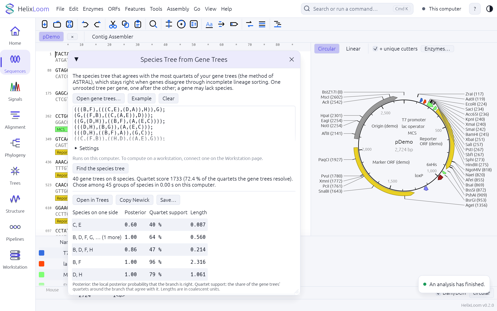

# Species trees from gene trees (the ASTRAL method)

Different genes of the same species often tell different stories: when species split close together in time, the gene
histories sort by chance (*incomplete lineage sorting*), and a tree of one gene can disagree with the species tree. The
ASTRAL method asks, for every set of four species, which of the three possible arrangements most gene trees show, and
builds the species tree that agrees with the most of them. Under the multispecies coalescent that tree is a consistent
estimate of the species tree, however many genes disagree. HelixLoom has its own implementation of it, for
"I have 2,000 gene trees, what is the species tree and how sure is each branch?".

## Using it

* **In the program**: Tools → *Species Tree from Gene Trees…*, or the command palette (Cmd+K, "species tree"), or the
  *More* section of the Phylogeny page. Paste the gene trees or open a file (Newick, one tree after the other, one
  unrooted tree per gene), press *Find the species tree*. *Example* loads 40 gene trees on 8 species that were simulated from
  a known species tree, so a first run can be checked against the truth (under *Settings*, tick *Score a species tree that I
  give* to score that tree too; *Settings* also has the search options). The result is a table of the inner branches with
  their posterior probability, quartet support and length, the tree as Newick, and buttons to open it on the Trees page,
  copy it, or save it.
* **Where it runs is your choice**, as for every heavy job. Once a workstation is connected on the Workstation page, the
  window shows the same three-way choice as the other pages, between the settings and the button: *This computer*,
  *Workstation* (the machine with the GPUs, over `helixloom serve`) and *Automatic* (a job with more than 50,000 leaves in all
  its gene trees, about the species times the genes, goes to the workstation, a smaller one stays here); a line under it says
  where this run will go. The same code runs in both places. The search needs no GPU: it uses every core of the machine it
  runs on, so a workstation helps it by its cores and its memory.
* **From a script or a cluster**: `helixloom astral -i genes.tre -o species.tre` (also `helixloom species-tree`). The
  options are the ones of ASTRAL that the engine has:

  | Option | Meaning |
  |--------|---------|
  | `-i`, `--input FILE` | the gene trees (a last argument that is no option is taken as the input) |
  | `-o`, `--output FILE` | where to write the tree (the standard output when left out) |
  | `-q`, `--score-tree FILE` | do not search: score and annotate this binary species tree |
  | `-t`, `--branch-annotate N` | 0 nothing, 1 quartet support in percent, 2 everything, 3 local posterior probability (default), 4 the three posteriors, 8 the three quartet supports |
  | `-x`, `--exact` | look at every group of species (at most 12 species) |
  | `-p`, `--extraLevel N` | 0: only the gene trees' own splits; 1 (default): also the ways to resolve polytomies |
  | `-c`, `--lambda X` | the Yule prior of the branch lengths (default 0.5; 0 gives maximum likelihood lengths) |
  | `-m`, `--minleaves N` | leave out gene trees with fewer leaves |
  | `--root TAXON` | hang the tree from this species when writing it (a tree given with `-q` too); a name with a space, a bracket, a comma, a colon or a quote is written in single quotes |
  | `--no-polish`, `--polylimit N` | do not swap neighbouring groups after the search; the largest polytomy whose pairs are joined (8) |

  The log goes to the standard error, the tree to the output, and the exit code is 0 when it worked.
* **On the workstation**: the job kind is `species`. A request holds the gene trees (at most 20,000 of them and 20,000,000
  leaves in all), the settings, and optionally a tree to score; the answer holds the tree and its branch table. The search
  itself refuses trees whose sets of species would take more than 8 GB of memory, and says so. `DEPLOY.md` section 10 is the
  recipe this followed.

## What the numbers mean

* **Quartet score** (and the normalized score, as a share of all the quartets the gene trees resolve): how many quartets
  of the species tree appear in the gene trees. The search maximizes it.
* **Posterior** (`pp1`): the local posterior probability that the branch is right, given the three arrangements around it
  and a uniform prior. Higher is better; 0.95 and above is usually taken as strong.
* **Quartet support** (`q1`): the share of the gene trees' quartets around the branch that agree with it. A branch can be
  right with a quartet support of 40 % (the other two arrangements then have 30 % each): that is what incomplete lineage
  sorting looks like, and a low support there is not a flaw of the method.
* **Length**: in coalescent units, from how often the gene trees agree with the branch (the more they disagree, the shorter
  it is); it is only defined for the inner branches.
* The tree has no root: it is written hanging from the first species (or the one named in *Hang the tree from*).

## How it works

1. The gene trees give a set of *groups of species* (a branch splits the species in two groups; a gene tree that lacks
   species is completed from a guide tree made of all of them, and for a polytomy every way to join two of its branches is
   added, up to eight branches). The species tree is chosen from these groups only.
2. A dynamic programme over the groups finds the tree of groups that scores best: the score of a group split in two
   depends only on the group and its parts, so the best tree for a group is built from the best trees of its parts.
3. A score is counted without listing quartets: at each node of the species tree, the quartets that a gene tree resolves
   the same way are counted from the sizes of the groups on its branches, so the work grows with the number of branches,
   not with the fourth power of the number of species.
4. After the search, neighbouring groups are swapped while the score rises; the number of branches checked is small.
5. Every inner branch is annotated from the three counts of quartets around it (the branch's arrangement and the two
   alternatives): the posterior from the incomplete beta function, the length from the share that disagrees.

The exact formulas and the checks are in `MECHANICS.md`, section 9.

## How it was checked

It was written from the papers and the tutorials, never from the programs' code, and compared with ASTRAL 5.7.8 run as a
black box:

* On twelve data sets of 6 to 80 species and 30 to 200 genes simulated under the multispecies coalescent (some with
  polytomies and missing species), for four species trees each (the tree the genes came from and others), the quartet
  score, the normalized score and, on every inner branch, the quartet counts, the effective number of genes, the quartet
  support, the posterior probability and the branch length are the same as ASTRAL's (`src/seq/astral/golden/`). Only the
  very smallest posteriors differ, in the seventh digit, and there this program agrees with the formula worked out to 40
  digits and ASTRAL does not (its 1.413315132e-5 is 8e-8 off the exact 1.413315017e-5).
* The best tree the search finds has at least ASTRAL's score on all twelve, and the exact search finds the optimum
  ASTRAL's exact search found on the six that are small enough for it.
* Counting the quartets one by one agrees with the fast counts, and the exact search agrees with trying every tree, for
  all trees of up to seven species.
* On eight larger sets (25 species and 200 genes, 40 and 400, 60 and 600; and 30 and 300, 50 and 200, 80 and 150, 15 and
  500, 24 and 120, in which each species is missing from a gene with a probability of up to a half and each inner branch of
  a gene tree is collapsed into a polytomy with a probability of up to a half) the best quartet scores of the two programs
  are the same to the last digit.

| Species × genes | This program | ASTRAL 5.7.8 (with the start of the Java machine) |
|-----------------|--------------|---------------------------------------------------|
| 25 × 200 | 0.2 s | 1 s |
| 40 × 400 | 1.8 s | 12 s |
| 60 × 600 | 7.9 s | 42 s |

(One busy Apple-silicon Mac; both programs used all its cores. The three larger sets are generated data that this
repository does not keep; `src/seq/astral/golden/make/` has the scripts that make such sets, so the comparison can be run
again.)

## Limits

* **Size.** The search keeps a set of species for about three nodes of every gene tree and refuses trees that would need
  more than 8 GB of them, or whose quartets could not be counted in 64 bits (more than about 18,000 species in 2,000 genes);
  a workstation request holds at most 20,000 gene trees and 20,000,000 leaves; the exact search takes at most 12 species.
* **Speed.** The time grows with the species, the genes and, above all, the number of *groups of species* the search has to
  choose from (it looks at pairs of them): a few thousand for genes that share most of their species (the timings above), more
  when each gene has species that no other gene has. What a gene lacks is put back one species at a time, near its relatives
  in a guide tree, and the genes are shared out among the cores for that: 200 genes of four species each, on 800 species
  that no two of them share, take about a second. **With more than 1,500 species there is no guide tree** (making one is
  cubic in the species), so the gene trees that lack species are not completed and the search chooses from the groups the
  gene trees give, plus a chain that makes sure some tree can be built; the log says so. That is a cruder search than
  ASTRAL's for such sets, and the other ASTER programs are the ones built for them. The polish after the search (swapping
  neighbouring groups) has a budget of about ten seconds of work, so on very large inputs it does fewer sweeps or none. A
  search that would have more than a million groups is refused as soon as that is known, with a message that says why,
  rather than left to run for hours.
* **Names** in a result that comes back from the workstation are cut to 200 characters, and a table of branches too large to
  send (a tree as deep as it is wide lists every species below every branch) comes with its first rows only; the tree has
  them all.

## What is not built yet

ASTER is a family of programs; this is the ASTRAL core of it. Not in this release: weighted ASTRAL (gene trees with branch
lengths or supports as weights, `wastral`), ASTRAL-Pro3 for gene families with several copies per species (a species twice
in a tree is refused with a message that says so), ASTRAL-IV's placement heuristic for very large sets, the CASTLES-II
branch lengths in substitution units, CASTER and WASTER (from genome alignments and reads), SISTER, the D* test for
hybridization, mapping several individuals to one species (`-a`), bootstrap over gene trees, and the polytomy test. Each is
a separate step in `ROADMAP.md`.

## Where it comes from

Mirarab, Reaz, Bayzid, Zimmermann, Swenson and Warnow (2014), *ASTRAL*; Mirarab and Warnow (2015), *ASTRAL-II*; Zhang,
Rabiee, Sayyari and Mirarab (2018), *ASTRAL-III*; Sayyari and Mirarab (2016), *Fast coalescent-based computation of local
branch support from quartet frequencies*; Zhang and Mirarab (2022) and Zhang, Nielsen and Mirarab (2025) for the ASTER family.
ASTRAL is under the Apache License 2.0. ASTER is under the **GNU Affero General Public License 3.0**, which would apply to
anything copied from it, so none of its code was read into this program; the licence of HelixLoom itself is the owner's
decision (`ROADMAP.md`, questions for the owner). See `CREDITS.md`.
