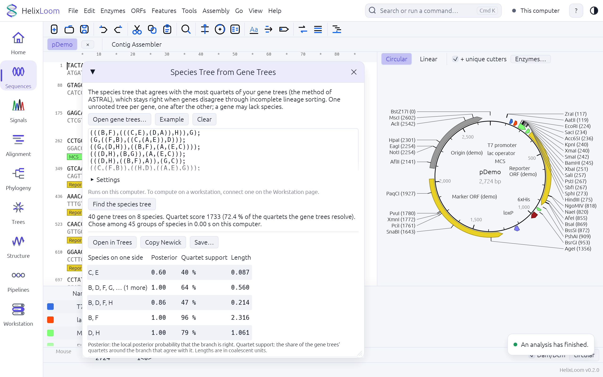

# Species trees from gene trees (the ASTRAL method)

Different genes of the same species often tell different stories: when species split close together in time, the gene
histories sort by chance (*incomplete lineage sorting*), and a tree of one gene can disagree with the species tree. The
ASTRAL method asks, for every set of four species, which of the three possible arrangements most gene trees show, and
builds the species tree that agrees with the most of them. Under the multispecies coalescent that tree is a consistent
estimate of the species tree, however many genes disagree. HelixLoom has its own implementation of it, for
"I have 2,000 gene trees, what is the species tree and how sure is each branch?".

## Using it

* **In the program**: Tools → *Species Tree from Gene Trees…*, or the command palette (Cmd+K, "species tree"), or the
  *More* section of the Phylogeny page. Paste the gene trees or open a file (Newick, one tree after the other, one
  unrooted tree per gene), press *Find the species tree*. *Example* loads 40 gene trees on 8 species that were simulated from
  a known species tree, so a first run can be checked against the truth (under *Settings*, tick *Score a species tree that I
  give* to score that tree too; *Settings* also has the search options). The result is a table of the inner branches with
  their posterior probability, quartet support and length, the tree as Newick, and buttons to open it on the Trees page,
  copy it, or save it.
* **Where it runs is your choice**, as for every heavy job. Once a workstation is connected on the Workstation page, the
  window shows the same three-way choice as the other pages, between the settings and the button: *This computer*,
  *Workstation* (the machine with the GPUs, over `helixloom serve`) and *Automatic* (a job with more than 50,000 leaves in all
  its gene trees, about the species times the genes, goes to the workstation, a smaller one stays here); a line under it says
  where this run will go. The same code runs in both places. The search needs no GPU: it uses every core of the machine it
  runs on, so a workstation helps it by its cores and its memory.
* **From a script or a cluster**: `helixloom astral -i genes.tre -o species.tre` (also `helixloom species-tree`). The
  options are the ones of ASTRAL that the engine has:

  | Option | Meaning |
  |--------|---------|
  | `-i`, `--input FILE` | the gene trees (a last argument that is no option is taken as the input) |
  | `-o`, `--output FILE` | where to write the tree (the standard output when left out) |
  | `-q`, `--score-tree FILE` | do not search: score and annotate this binary species tree |
  | `-t`, `--branch-annotate N` | 0 nothing, 1 quartet support in percent, 2 everything, 3 local posterior probability (default), 4 the three posteriors, 8 the three quartet supports, 10 the p-value of the polytomy test (same as `--polytomy`) |
  | `--polytomy` | test every branch for being a polytomy (see *Polytomy test* below); the p-values are the labels of the branches |
  | `-x`, `--exact` | look at every group of species (at most 12 species) |
  | `-p`, `--extraLevel N` | 0: only the gene trees' own splits; 1 (default): also the ways to resolve polytomies |
  | `-c`, `--lambda X` | the Yule prior of the branch lengths (default 0.5; 0 gives maximum likelihood lengths) |
  | `-m`, `--minleaves N` | leave out gene trees with fewer leaves |
  | `-r`, `--replicates N` | bootstrap replicates (100 when `-b` or `--gene-only` is given without it; see *Bootstrap support* below) |
  | `-b`, `--bootstrap LIST` | a file listing the files of bootstrap trees of the genes: the sites are resampled |
  | `-g`, `--genes-and-sites` | with `-b`: the genes are drawn with replacement too |
  | `--gene-only` | resample the genes only, from the gene trees alone |
  | `-s`, `--seed N` | the seed of the resampling (default 692) |
  | `--replicate-trees FILE`, `--consensus FILE` | also write the species tree of every bootstrap replicate, and their greedy consensus (see *Bootstrap support*) |
  | `-f`, `--families` | the gene trees are gene family trees, with several copies of a species in a tree (ASTRAL-Pro; see *Gene families* below) |
  | `-w`, `--weights NAME` | weighted ASTRAL: `none` (the default), `support`, `length` or `hybrid` (see *Weighted ASTRAL* below) |
  | `--root TAXON` | hang the tree from this species when writing it (a tree given with `-q` too); a name with a space, a bracket, a comma, a colon or a quote is written in single quotes |
  | `--no-polish`, `--polylimit N` | do not swap neighbouring groups after the search; the largest polytomy whose pairs are joined (8) |

  The log goes to the standard error, the tree to the output, and the exit code is 0 when it worked.
* **On the workstation**: the job kind is `species`. A request holds the gene trees (at most 20,000 of them and 20,000,000
  leaves in all), the settings, and optionally a tree to score; the answer holds the tree and its branch table. The search
  itself refuses trees whose sets of species would take more than 8 GB of memory, and says so. `DEPLOY.md` section 10 is the
  recipe this followed. A request names the weights (`weights=`) and the result says how the quartets were weighted; a workstation
  from before the weights ignores the line, and the app refuses an answer that was not weighted as asked.

## Weighted ASTRAL

A gene tree is not equally sure of all its quartets: a quartet that rests on a branch with a support of 0.3 is a poor witness,
and one whose species are far from each other (long paths) is noisier than one whose species are close. Weighted ASTRAL (Zhang
and Mirarab 2022) counts each quartet of a gene tree not as 1 but as a weight between 0 and 1, so that a few sure gene trees
can outweigh many unsure ones, which makes the species tree more accurate when the gene trees are poorly resolved.

* **In the program**: *Settings ▸ Weights* of the species-tree window; **from a script**: `helixloom astral -w hybrid`.
  * `support`: the weight of a quartet `ab|cd` is `1 − Π (1 − s)` over the branches between the two nodes of the gene tree
    where `a b` and `c d` meet: the chance that at least one of them is right. The supports are the **labels of the inner
    branches** of the gene trees, as written by IQ-TREE, RAxML or FastTree (0 to 1; if any label of the input is above 1 they
    are percentages).
  * `length`: the weight is `exp(−(l(a,b) + l(c,d)))`, the lengths of the paths between the two species of each pair, in
    substitutions per site.
  * `hybrid`: both, multiplied (the general choice of the paper).
* **What the gene trees must have**: supports for `support` and `hybrid`, lengths for `length` and `hybrid`. A tree that has
  none is refused with its number; a branch without a support is taken as fully supported, a branch without a length as of length
  0, and the log says how many. A label that is not one number (IQ-TREE's `95/100`) is refused: keep one value in each label.
* **The result** shows the quartet score as before (each shared quartet counted one) and the *weighted* score (their weights
  added up); the normalized score is the weighted one over the quartets the gene trees resolve.
* **What is not weighted**: the branch support (posterior, quartet support) and the branch lengths on the output are
  ASTRAL's, counted on the quartets without their weights. The paper's weighted support is not built (the fetched text of its
  normalisation was not legible enough to write it from), and the window and the log say so.
* **Cost**: one weighted count is about 2.2 times a plain one (measured), so a weighted run takes about that much longer, and
  *Automatic* counts its trees as a bigger job.
* **How it was checked**: against the definition, quartet by quartet, on random trees (`src/seq/astral/wtests.rs`); with every
  support 1 it is ASTRAL's result exactly. **It has not been compared with wastral**, whose program was not run: its trees and
  scores are not confirmed to equal wastral's, and the search here is the ASTRAL dynamic programme with the weighted score, not
  wastral's own search. (wastral resolves the polytomies of the gene trees at random, with a support and a length of 0; the quartets
  those branches decide then have no weight, as a polytomy gives them here.)

## Bootstrap support

The posterior and the quartet support of a branch say how the gene trees you have agree with it; a bootstrap says how much the
answer would change with other gene trees. The search is run again on many resamplings, and the number on a branch is the share
of the species trees found (in percent) that have the branch.

* **In the program**: *Settings ▸ Bootstrap replicates* of the species-tree window (0 is none), *Resample*, *Seed*. The result
  table gets a *Bootstrap* column, and the Newick has the support as the label of each branch (instead of the posterior).
  **From a script**: `helixloom astral -i genes.tre --gene-only -r 100`.
* **What a replicate is** (the three ways of ASTRAL's bootstrap):
  * `genes` (`--gene-only`): as many gene trees as there are, drawn with replacement from the gene trees.
  * `sites` (`-b LIST`): every gene has bootstrap trees of its own, from bootstrapping its alignment; replicate `r` takes the
    `r`-th bootstrap tree of every gene, so each gene needs at least as many as there are replicates.
  * `both` (`-b LIST -g`, the multilocus bootstrap of Seo 2008): the genes are drawn with replacement, and for each gene drawn one
    of its bootstrap trees is drawn.
* **The list** for `-b` has one path to a line (blank lines and lines that start with `#` are left out; a relative path is
  taken from the folder of the list), one file for each gene tree of the input, in its order, each file holding that gene's
  bootstrap trees. A gene tree that is left out as too small takes its place in the list: give its file anyway. In the window,
  *Bootstrap trees of the genes…* reads the same list.
* **The seed** makes it repeatable: the same input, replicates and seed give the same support, on any computer.
* **Cost**: every replicate is a whole search, so a run takes about as many searches as it has replicates and one more. On the
  example (40 genes, 8 species) 100 replicates take 0.8 s; *Automatic* counts the replicates in the size of the job, and the job
  on the workstation carries the replicates, the seed and the bootstrap trees (at most 1,000 replicates and 256 MB of trees).
* **A replicate that gives no tree** (the genes drawn leave a species with nothing to place it by) is left out and counted, and the
  support is the share of those that did give one; the log and the window say how many did. Nothing is given if none did.
* **The replicate trees and their greedy consensus** (`--replicate-trees FILE`, `--consensus FILE`; the command line only): the species
  tree of every replicate that gave one, a line each, and the greedy consensus of them: the splits are taken in the order of how many
  replicates have them (ties settled by the taxa of the split, so the order of the replicates does not matter), each kept if it fits
  in one tree with the ones kept before, so it has every split that more than half of the replicates have and as many others as can be
  added; each branch is labelled with the share of the replicates (in percent) that have it, and there are no lengths. ASTRAL writes
  the replicate trees and the consensus before the main tree in one file; here they are files of their own and the main tree is
  as it was. Checked against a plain version written with sorted lists of numbers on random trees (the same choice; every pair of
  kept splits fits; every majority split is kept; none that was left out could have been added; the order of the trees does not
  matter) and by reading the written tree back. Not compared with ASTRAL's consensus.
* **With the weights**: a bootstrap of the **genes** works with weighted ASTRAL (`-w`): a gene that is drawn takes its supports and
  lengths with it, and each replicate is a weighted search. Checked on genes of which a third have a support of 0 (they weigh nothing):
  the weighted bootstrap gives full support to the branch the others agree on, where the unweighted one does not. Resampling the
  **sites** with weights is refused, with the reason: the bootstrap trees of the sites have no supports or lengths to weigh by.
* **Not built**: the bootstrap of the gene families (refused, with the reason), and the replicate trees and the consensus in the
  window and the workstation job.
* **How it was checked**: against the definition by cases that have a known answer (genes that all agree give 100 on every
  branch; replicates that take the first ten of twenty bootstrap trees per gene give 100 and all twenty give exactly 50; a
  split set of genes gives a support strictly between 0 and 100, the same for the same seed), the real command, the job and the
  window. **It has not been compared with ASTRAL's bootstrap**, which was not run: the way ASTRAL picks the tree of a gene for
  the sites alone (here the `r`-th) and what it does with a species that the genes drawn lack (here the replicate is counted as
  failed) are not given by its tutorial, so those two choices are this program's.

## Polytomy test

Is a short inner branch of the species tree real, or should it be a polytomy? With no branch at all, the gene trees show each of
the three ways to resolve the four groups around it equally often, a third each (incomplete lineage sorting alone); a branch with
a length makes its own arrangement more frequent. The test of Sayyari and Mirarab (2018), *Genes* 9:132, asks whether the three
counts around a branch are further from a third each than chance would make them. **`-t 10`** (ASTRAL's spelling) or
**`--polytomy`**, and *Settings ▸ Polytomy test* in the window.

* **What is counted**: for the branch, the four groups of species around it (the two below, the sibling, the rest). A gene tree
  that resolves some quartet made of one species from each group gives **one count in all**, divided among the three
  arrangements by the shares of its resolved quartets (a quartet the tree lacks a species for, or leaves as a polytomy, is left
  out, not counted for any). A gene tree that resolves none is left out for that branch. So `n1 n2 n3` add up to the number of
  gene trees that count. For complete binary gene trees they are the frequencies that `-t 2` prints as `f1 f2 f3`; they differ
  from those when gene trees have polytomies or lack species, where `f` divides by all the quartets with the four species
  present.
* **The statistic**: `chi2 = sum over the three of (n_i - n/3)^2 / (n/3)` with `n = n1 + n2 + n3`, on **2 degrees of freedom**,
  so the p-value is exactly `exp(-chi2 / 2)`. Each gene tree counts once, however many quartets it has around the branch (the
  paper's conservative choice, since quartets of one gene tree are not independent).
* **Only from 10 gene trees**: with fewer than 10 that count, the paper does not apply the test, and neither does this program:
  the branch has no p-value (a dash in the table; only its length in the Newick).
* **The result**: a p-value under 0.05 says the branch has a length (bold in the table). A larger one **does not say it has
  none**: the test may only be too weak for the number of genes, so the branch can be collapsed into a soft polytomy, not proved to
  be one. The branches are tested one by one with **no correction for how many** there are, and adjacent branches are not
  independent (the paper says Bonferroni or FDR corrections could be applied; they are not). The test rests on the coalescent
  with the species tree's other branches right and gene trees without error; error in the gene trees makes it reject too often.
* **Output**: with `-t 10` or `--polytomy` the label of each tested branch in the Newick is its p-value (three decimals, or
  `5.5E-4` when smaller); an untested branch has only its length; `-t 0` writes no labels; a bootstrap support, if asked for,
  stays the label. The log says how many branches were tested and how many the test cannot tell from a polytomy at 0.05. The window
  has a *Polytomy p* column (the statistic and the number of gene trees in the hover text), and the result of a workstation job
  has the same in a fifteenth field of each branch row.
* **Not with** the gene families (no table of quartet counts to test: refused, with the reason). With weights it is counted
  without them, as the posterior is, and the log says so. It also works on a given tree (`-q`).
* **How it was checked**: the counts against counting every quartet one by one on random gene trees with polytomies and missing
  species; the statistic and p-value against values worked by hand and the 5 % point of a chi-squared on 2 degrees (5.9915); the
  p-values of the real command against the chi-squared of the frequencies that `-t 2` prints for the example; the job and the
  window. **It has not been compared with ASTRAL's `-t 10`**, which was not run: the paper's text was read, not the program's
  code, so whether ASTRAL divides each gene tree's counts as the paper says (by the resolved quartets) is taken from the paper, and
  the 10-gene-tree minimum is the paper's. For complete binary gene trees the two readings agree.

## Gene families (ASTRAL-Pro)

A gene that was duplicated gives a tree in which a species occurs more than once, and the copies that came from a duplication
are *paralogs*: they say how the copies are related, not how the species are. ASTRAL cannot take such trees (it refuses a
species that occurs twice). With `--families` (the setting *The gene trees are gene families* in the window) the trees are read
as the paper of ASTRAL-Pro (Zhang, Scornavacca, Molloy and Mirarab 2020) reads them.

* **The trees**: Newick, one after the other, the leaf labels being the **species names**, repeated for every copy (rename
  `speciesA_gene7` to `speciesA` first). Binary trees only: a node that joins more than two branches is refused with the
  number of the tree (resolve the polytomies first), except that an unrooted tree has three branches at its top.
* **Rooting**: a tree whose top joins two branches is taken as rooted as it is written. One whose top joins three is rooted
  where the cost is least, counting one for every duplication and one for every loss that the two branches of a node ask for
  (none when they have the same species, one when those of one branch are among those of the other, two otherwise;
  speciations cost nothing). The first of the equally good places is taken.
* **Duplications**: a node is a duplication when the species below its two branches overlap, and a speciation when they do
  not. Only speciations are read as telling how species are related.
* **The score** is the number of *quartet classes* of the family trees that the species tree has: four different species whose
  every three leaves meet at a speciation, counted once for each place in the tree where the pairs of the quartet meet. With one
  copy of each species it is exactly ASTRAL's score. The search is the same dynamic programme over the groups of species that
  single-copy trees sampled from the families suggest (at every duplication one of the two branches is dropped, at random but
  the same every time; eight trees from each family).
* **What it does not give**: no branch support, no branch length: the species tree is written bare (the paper's local
  posterior for gene families is not built, because the text of its formulas was garbled where it was read). It cannot be used
  with the weights. The log and the window say so.
* **How it was checked**: the per-node count was *derived here from the paper's definitions* (the paper's formula, as it was
  read, was garbled) and checked against the definitions themselves: for random trees with several copies of some species,
  the classes counted one four-leaf set at a time (distinct species, every three leaves meeting at a speciation, classes
  told apart by their species and the node where the pairs meet) are as many as the formula says, for random species trees
  (`src/seq/astral/ftests.rs`); with one copy per species it gives ASTRAL's score and tree. **It has not been compared
  with the ASTRAL-Pro program** (not run, not read), and the rooting rule and the species-overlap tagging are the paper's as
  they were read, so its trees and scores are not confirmed to equal ASTRAL-Pro's. It is the 2020 method; the placement
  algorithm of ASTRAL-Pro 2 and the changes of ASTRAL-Pro3 are not built.

## What the numbers mean

* **Quartet score** (and the normalized score, as a share of all the quartets the gene trees resolve): how many quartets
  of the species tree appear in the gene trees. The search maximizes it.
* **Posterior** (`pp1`): the local posterior probability that the branch is right, given the three arrangements around it
  and a uniform prior. Higher is better; 0.95 and above is usually taken as strong.
* **Quartet support** (`q1`): the share of the gene trees' quartets around the branch that agree with it. A branch can be
  right with a quartet support of 40 % (the other two arrangements then have 30 % each): that is what incomplete lineage
  sorting looks like, and a low support there is not a flaw of the method.
* **Length**: in coalescent units, from how often the gene trees agree with the branch (the more they disagree, the shorter
  it is); it is only defined for the inner branches.
* The tree has no root: it is written hanging from the first species (or the one named in *Hang the tree from*).

## How it works

1. The gene trees give a set of *groups of species* (a branch splits the species in two groups; a gene tree that lacks
   species is completed from a guide tree made of all of them, and for a polytomy every way to join two of its branches is
   added, up to eight branches). The species tree is chosen from these groups only.
2. A dynamic programme over the groups finds the tree of groups that scores best: the score of a group split in two
   depends only on the group and its parts, so the best tree for a group is built from the best trees of its parts.
3. A score is counted without listing quartets: at each node of the species tree, the quartets that a gene tree resolves
   the same way are counted from the sizes of the groups on its branches, so the work grows with the number of branches,
   not with the fourth power of the number of species.
4. After the search, neighbouring groups are swapped while the score rises; the number of branches checked is small.
5. Every inner branch is annotated from the three counts of quartets around it (the branch's arrangement and the two
   alternatives): the posterior from the incomplete beta function, the length from the share that disagrees.

The exact formulas and the checks are in `MECHANICS.md`, section 9.

## How it was checked

It was written from the papers and the tutorials, never from the programs' code, and compared with ASTRAL 5.7.8 run as a
black box:

* On twelve data sets of 6 to 80 species and 30 to 200 genes simulated under the multispecies coalescent (some with
  polytomies and missing species), for four species trees each (the tree the genes came from and others), the quartet
  score, the normalized score and, on every inner branch, the quartet counts, the effective number of genes, the quartet
  support, the posterior probability and the branch length are the same as ASTRAL's (`src/seq/astral/golden/`). Only the
  very smallest posteriors differ, in the seventh digit, and there this program agrees with the formula worked out to 40
  digits and ASTRAL does not (its 1.413315132e-5 is 8e-8 off the exact 1.413315017e-5).
* The best tree the search finds has at least ASTRAL's score on all twelve, and the exact search finds the optimum
  ASTRAL's exact search found on the six that are small enough for it.
* Counting the quartets one by one agrees with the fast counts, and the exact search agrees with trying every tree, for
  all trees of up to seven species.
* On eight larger sets (25 species and 200 genes, 40 and 400, 60 and 600; and 30 and 300, 50 and 200, 80 and 150, 15 and
  500, 24 and 120, in which each species is missing from a gene with a probability of up to a half and each inner branch of
  a gene tree is collapsed into a polytomy with a probability of up to a half) the best quartet scores of the two programs
  are the same to the last digit.

| Species × genes | This program | ASTRAL 5.7.8 (with the start of the Java machine) |
|-----------------|--------------|---------------------------------------------------|
| 25 × 200 | 0.2 s | 1 s |
| 40 × 400 | 1.8 s | 12 s |
| 60 × 600 | 7.9 s | 42 s |

(One busy Apple-silicon Mac; both programs used all its cores. The three larger sets are generated data that this
repository does not keep; `src/seq/astral/golden/make/` has the scripts that make such sets, so the comparison can be run
again.)

## Limits

* **Size.** The search keeps a set of species for about three nodes of every gene tree and refuses trees that would need
  more than 8 GB of them, or whose quartets could not be counted in 64 bits (more than about 18,000 species in 2,000 genes);
  a workstation request holds at most 20,000 gene trees and 20,000,000 leaves; the exact search takes at most 12 species.
* **Speed.** The time grows with the species, the genes and, above all, the number of *groups of species* the search has to
  choose from (it looks at pairs of them): a few thousand for genes that share most of their species (the timings above), more
  when each gene has species that no other gene has. What a gene lacks is put back one species at a time, near its relatives
  in a guide tree, and the genes are shared out among the cores for that: 200 genes of four species each, on 800 species
  that no two of them share, take about a second. **With more than 1,500 species there is no guide tree** (making one is
  cubic in the species), so the gene trees that lack species are not completed and the search chooses from the groups the
  gene trees give, plus a chain that makes sure some tree can be built; the log says so. That is a cruder search than
  ASTRAL's for such sets, and the other ASTER programs are the ones built for them. The polish after the search (swapping
  neighbouring groups) has a budget of about ten seconds of work, so on very large inputs it does fewer sweeps or none. A
  search that would have more than a million groups is refused as soon as that is known, with a message that says why,
  rather than left to run for hours.
* **Names** in a result that comes back from the workstation are cut to 200 characters, and a table of branches too large to
  send (a tree as deep as it is wide lists every species below every branch) comes with its first rows only; the tree has
  them all.

## What is not built yet

ASTER is a family of programs; this is the ASTRAL core of it with the weights of weighted ASTRAL (and without its weighted branch
support), and the gene family score of ASTRAL-Pro (2020; without branch supports). Not in this release: the placement
algorithm of ASTRAL-Pro 2 and the changes of ASTRAL-Pro3 (a species twice in a tree is read only with `--families`, and is
refused with a message that says so otherwise), ASTRAL-IV's placement heuristic for very large sets, the CASTLES-II
branch lengths in substitution units, CASTER and WASTER (from genome alignments and reads), SISTER, the D* test for
hybridization and mapping several individuals to one species (`-a`). Each is a separate step in `ROADMAP.md`.

## Where it comes from

Mirarab, Reaz, Bayzid, Zimmermann, Swenson and Warnow (2014), *ASTRAL*; Mirarab and Warnow (2015), *ASTRAL-II*; Zhang,
Rabiee, Sayyari and Mirarab (2018), *ASTRAL-III*; Sayyari and Mirarab (2016), *Fast coalescent-based computation of local
branch support from quartet frequencies*; Sayyari and Mirarab (2018), *Testing for polytomies in phylogenetic species trees using
quartet frequencies*; Zhang and Mirarab (2022) and Zhang, Nielsen and Mirarab (2025) for the ASTER family.
ASTRAL is under the Apache License 2.0. ASTER is under the **GNU Affero General Public License 3.0**, which would apply to
anything copied from it, so none of its code was read into this program: HelixLoom is under the MIT licence. See `CREDITS.md`.
